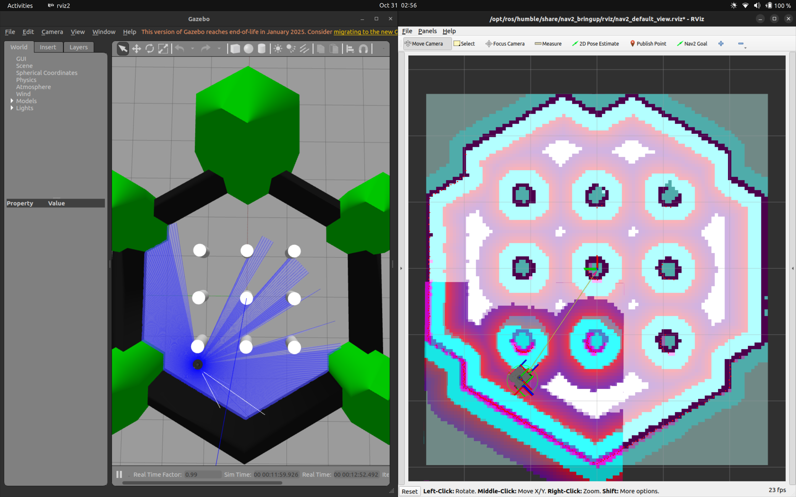
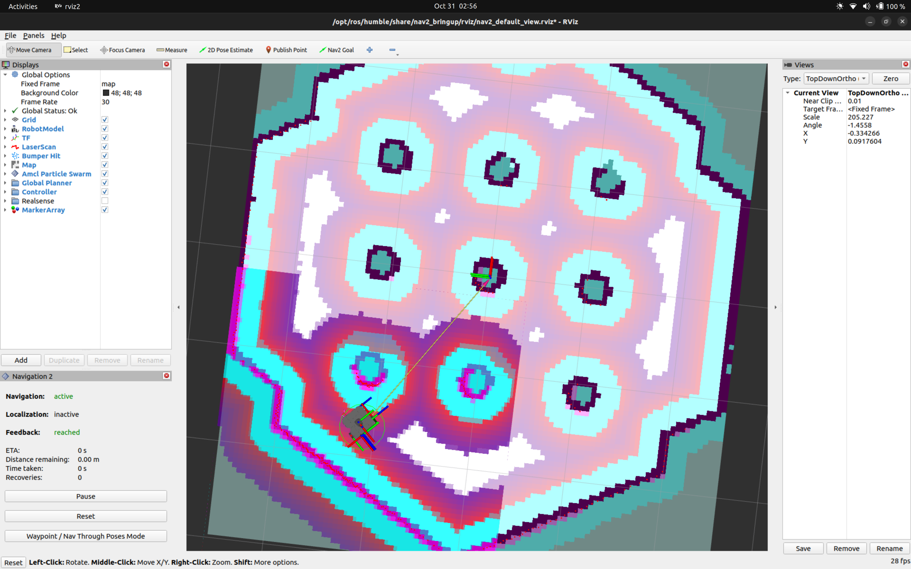

# Autonomous Navigation with TurtleBot3 and Nav2 in Gazebo

Submission for the **Robotics Software Intern Assignment** at **Antropi Robotics**.

A TurtleBot3 Waffle robot navigates autonomously to goals while avoiding obstacles in Gazebo Classic, using the ROS 2 Navigation2 (Nav2) stack with a pre-built map and AMCL localization. The whole simulation (Gazebo, Nav2, RViz) starts from a single launch file.

---

## Demo

> Full demonstration video: [[video link](https://youtu.be/9oqLiq60k0Y)]

---

## System Specifications

| Component | Version |
|---|---|
| OS | Ubuntu 22.04 LTS |
| ROS 2 | Humble Hawksbill |
| Simulator | Gazebo Classic 11 |
| Robot | TurtleBot3 (`waffle`) |
| Localization | AMCL with a saved map |
| Global planner | NavFn |
| Local controller | DWB |

---

## Prerequisites

### 1. Install dependencies

```bash
sudo apt update
sudo apt install -y \
  ros-humble-navigation2 \
  ros-humble-nav2-bringup \
  ros-humble-turtlebot3 \
  ros-humble-turtlebot3-gazebo \
  ros-humble-turtlebot3-simulations \
  ros-humble-turtlebot3-teleop \
  ros-humble-slam-toolbox \
  gazebo11 \
  libgazebo11-dev
```

### 2. Configure the environment ( for permanent changes will add in .bashrc file)

```bash
cat << 'EOF' >> ~/.bashrc
# TurtleBot3 & Gazebo setup
source /opt/ros/humble/setup.bash
source /usr/share/gazebo/setup.bash
export TURTLEBOT3_MODEL=waffle
EOF

source ~/.bashrc
```

---

## Quick Start (Run the Demo)

```bash
# 1. Clone the package into a workspace
mkdir -p ~/turtle-bot3_ws/src
cd ~/turtle-bot3_ws/src
git clone <your-repo-url> turtle_pkg

# 2. Build
cd ~/turtle-bot3_ws
colcon build --symlink-install
source install/setup.bash

# 3. Launch Gazebo + Nav2 + RViz
ros2 launch turtle_pkg launch_sim.launch.py
```

Then, in RViz:

1. Click **2D Pose Estimate** and click and drag on the map at the robot's position, with the arrow pointing in the direction the robot faces. AMCL needs this before it can localize. The `AMCL cannot publish a pose` warnings stop once it is set.
2. Click **Nav2 Goal** and click and drag on a free area of the map to set the destination.
3. The robot plans a path and drives to the goal, replanning around obstacles detected by the laser scan.

To show obstacle avoidance clearly, insert a box in front of the robot in Gazebo (Insert tab) while it is driving and watch the local costmap and path update.

---

## What the Launch File Does

`launch/launch_sim.launch.py` replaces the three manual commands used during development:

1. Sets `TURTLEBOT3_MODEL=waffle`.
2. Starts Gazebo with the `turtlebot3_world` environment and spawns the robot.
3. After a short delay (so Gazebo and the robot are up first), starts Nav2 (`turtlebot3_navigation2/navigation2.launch.py`) with:
   - `use_sim_time:=True`
   - the saved map from `maps/turtle_map.yaml`
   - the Nav2 parameters from `params/nav2_waffle.yaml`

Paths are resolved with `get_package_share_directory`, so nothing is hardcoded to a specific machine.

---

## Creating the Map (One-Time Step)

The map in `maps/` was built once with SLAM Toolbox and saved. To rebuild it, for example for a different world, run these in separate terminals. Do **not** run SLAM Toolbox together with the navigation launch file, because both would publish the `map -> odom` transform and conflict with AMCL.

```bash
# Terminal 1: simulation
ros2 launch turtlebot3_gazebo turtlebot3_world.launch.py

# Terminal 2: SLAM
ros2 launch slam_toolbox online_async_launch.py use_sim_time:=True

# Terminal 3: drive the robot around the whole environment
ros2 run turtlebot3_teleop teleop_keyboard

# Terminal 4: save the map once it looks complete in RViz
ros2 run nav2_map_server map_saver_cli -f ~/turtle-bot3_ws/src/turtle_pkg/maps/turtle_map
```

Stop all of the above, rebuild (`colcon build --symlink-install`), and use the Quick Start commands to navigate with the new map.

---

## In RViz
##### It is setting initial postion
1. Click <b>"2D Pose Estimate"</b> and click on the robot's actual location as in gazebo (<i>make sure lidar reading match to map</i>) .<br>

##### It is setting goal position</i><br>
2. Click <b>"2D Nav Goal"</b> and send a goal. <br>


## Repository Structure

```text
turtle_pkg/
├── maps/
│   ├── turtle_map.yaml        # Map metadata (resolution, origin, thresholds)
│   └── turtle_map.pgm         # 2D occupancy grid
├── params/
│   └── nav2_waffle.yaml       # Nav2 parameters (Humble-compatible)
├── launch/
│   └── launch_sim.launch.py   # Single launch file: Gazebo + Nav2 + RViz
├── setup.py                   # Installs launch/, maps/ and params/
└── README.md
```

---

## 📸 Screenshot of Mapping and Navigation





## Troubleshooting

**Gazebo crashes or `Entity [waffle] already exists`.** A previous Gazebo is still running. Stop it and relaunch:

```bash
pkill -9 gzserver; pkill -9 gzclient
```

**Gazebo or RViz crashes with graphics errors** (common in VMs or on hybrid-GPU laptops):

```bash
export LIBGL_ALWAYS_SOFTWARE=1
```
---

## Engineering Notes and Challenges

- **Nav2 parameter version mismatch.** The TurtleBot3 navigation params I first loaded used plugin names from a newer Nav2 release (for example `nav2_navfn_planner::NavfnPlanner`, plus docking and navigator settings that Humble does not have). Humble registers plugins as `nav2_navfn_planner/NavfnPlanner`, so `planner_server` failed to configure and the lifecycle manager aborted the entire Nav2 bringup. The fix was to use the parameter file shipped with Humble's `nav2_bringup` as the base (`params/nav2_waffle.yaml`) and pass it explicitly to the launch file.

- **SLAM Toolbox and AMCL both publish `map -> odom`.** Running SLAM Toolbox together with Nav2's map server and AMCL makes the two fight over the same transform and the `/map` topic. I split the workflow into two phases: map once with SLAM Toolbox, then navigate with the saved map and AMCL only.

- **Simulation clock synchronization.** All nodes, including RViz, run with `use_sim_time:=True` so they follow the `/clock` published by Gazebo. This avoids transform timestamp errors.

- **Launch ordering.** Nav2 is started through a `TimerAction` so that Gazebo and the robot's `/scan`, `/odom` and TF are available before the Nav2 lifecycle nodes configure.

- **Stale Gazebo processes.** Closing a terminal without a clean shutdown left an old `gzserver` running. The next launch then failed with `Entity [waffle] already exists`. Cleaning up with `pkill` before relaunching resolved it.

- **Missing `data_files` entries.** The `maps/` and `params/` folders must be listed in `setup.py` so they are installed into the package share directory. Otherwise Nav2 receives an empty or wrong path (`No such file or directory: ''`).

---

## Possible Improvements

- Set `set_initial_pose: true` in the AMCL params to skip the manual 2D Pose Estimate step.
- Tune the costmap inflation radius for tighter passages.
- Add waypoint following with Nav2's `waypoint_follower`.
